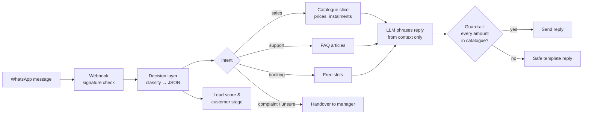

# WhatsApp AI Intent Router

A small, dependency-free reference implementation of a **WhatsApp AI sales assistant that can't invent prices**.

Most "ChatGPT in WhatsApp" bots paste the whole catalogue into one huge prompt and let the model decide everything. That causes made-up discounts, slow replies and unpredictable behaviour. This project splits the job in two:

1. **Decision layer**: every message is classified into a small, validated JSON object (intent, priority, needs-human, customer stage, topics). The code branches on that, not on free-form model output.
2. **Generation layer**: the LLM only phrases the answer, using a tiny slice of verified data. A **guardrail** then rejects any reply that mentions an amount not in the catalogue and falls back to a safe template.

> This is a public demo of the architecture I use in production at Nexis Digital. It uses a **fictional** catalogue ("AquaDemo" water filters) and no client data.
> Full write-up: [How to implement an AI WhatsApp bot: from intent classification to CRM loops](https://heyasheva.com/ai-shelf/kak-vnedrit-jev-kak-ai-bota-dlya-whatsapp)

## How it works



Example decision for *"Здравствуйте, сколько стоит фильтр под мойку? Есть рассрочка?"*:

```json
{
  "intent": "sales",
  "priority": "medium",
  "needs_human": false,
  "customer_stage": "new_lead",
  "confidence": 0.8,
  "topics": ["pricing", "installment"]
}
```

## Features

- **Intent classification**: an LLM with strict JSON output, validated and normalized, with an offline keyword fallback.
- **Context retrieval per intent**: only the relevant products, FAQ articles or booking slots reach the model.
- **Price guardrail**: replies mentioning an unverified amount (e.g. an invented "59 000 ₸ discount") are blocked.
- **Human handover**: complaints and low-confidence messages go to a manager automatically.
- **Lead scoring**: buying signals raise the score; a lead becomes *qualified* at 40+.
- **WhatsApp Cloud API**: webhook verification, `X-Hub-Signature-256` check and sending replies (dry-run without a token).
- **Zero dependencies**: Node.js 20+ only. Works fully offline for demos and tests.

## Run it

```bash
git clone https://github.com/ashevamr/whatsapp-ai-intent-router
cd whatsapp-ai-intent-router

npm run demo   # sample conversations, offline
npm test       # 12 tests
npm start      # webhook server on http://localhost:3000/webhook
```

To use a real LLM and WhatsApp, copy `.env.example` to `.env`, fill in the keys and export them (or use `node --env-file=.env src/server.js`).

Sample output of `npm run demo`:

```
📩 77010000001: Здравствуйте, сколько стоит фильтр под мойку? Есть рассрочка?
🧠 decision: {"intent":"sales","priority":"medium","needs_human":false,...}
📊 lead score: 20 · stage: new_lead
💬 reply (template):
Вот актуальные цены:
• Under-sink filter 3-stage: 89 000 ₸ (рассрочка 6 мес. по 14 834 ₸)
────────────────────────────────────────────
📩 77010000003: Это ужас, второй раз ломается, верните деньги!
🧠 decision: {"intent":"complaint","priority":"high","needs_human":true,...}
💬 reply (template, HANDOVER to manager):
Понимаю. Передаю ваш вопрос менеджеру, он ответит в ближайшее время.
```

## Project structure

```
src/
  classify.js   decision layer: LLM or rules → validated JSON
  context.js    per-intent retrieval + list of allowed amounts
  reply.js      LLM phrasing, templates, price guardrail
  pipeline.js   classify → retrieve → generate → validate → handover
  memory.js     customer stage & lead score (swap for your CRM)
  whatsapp.js   signature check, webhook parsing, sending
  server.js     minimal HTTP webhook server
data/           fictional catalogue, FAQ and slots
scripts/demo.js sample conversations
test/           node:test suite
```

## Design notes

- **Why not one big prompt?** Smaller context means faster, cheaper and more predictable replies, and the business logic stays in code you can test.
- **Why validate the model's JSON?** Models sometimes return unknown intents or out-of-range values. `validateClassification` maps them to safe defaults instead of crashing or branching wrongly.
- **Why a guardrail and not just a better prompt?** Prompts reduce mistakes; a check after generation guarantees a wrong price never reaches a customer.
- **Production next steps:** a persistent CRM instead of the in-memory store, a message queue for retries, analytics on handovers, and a voice channel sharing the same customer record ([write-up](https://heyasheva.com/ai-shelf/multimodal-voice-agent-architecture)).

## Author

**Adina Omarova**, AI Product Builder · [heyasheva.com](https://heyasheva.com) · [LinkedIn](https://www.linkedin.com/in/adina-omarova/)

MIT License
